# 2026-11-06 검사

## 마이크 녹음 → 대화 읽어주기 (`tools/walk-check/tts.cjs`)
- 마이크가 동작하지 않아 🎤 녹음 버튼을 🗣️ 읽어주기 켜기/끄기 버튼으로 바꿈. 대화를 치면 기기 안의 음성 합성(speechSynthesis)으로 읽음 — 녹음·서버 저장 없음.
- 여자 캐릭터는 여자 목소리, 남자 캐릭터는 남자 목소리. 기기에 한국어 남자 목소리가 없으면(아이폰 Yuna, 안드로이드 기본 1개) 같은 목소리를 낮게(pitch 0.52~0.8) 바꿈.
- 사람마다 기기 번호로 높낮이·빠르기를 정해서 여러 명이어도 구분됨(같은 사람은 늘 같은 목소리). 이모지는 빼고 'ㅋㅋ/ㅎㅎ'는 '크크/흐흐'로 읽음.
- 같은 층 사람 말만 읽음. 말하는 동안 찬송 반주를 살짝 줄임. 끄면 다음 방문에도 꺼진 채(`mdc_tts_off`).
- 예전 기기가 보낸 음성 메시지는 그대로 받아서 틀어 줌.

| 기기 목소리 | 혜연(나·여) | 은혜(여) | 철수(남) | 민준(남) | 지은(여) |
|---|---|---|---|---|---|
| 아이폰(Yuna 1개) | Yuna 1.25 | Yuna 1.1 | Yuna 0.6 | Yuna 0.72 | Yuna 1.06 |
| 안드로이드(이름 모름 1개) | 1.55 | 1.38 | 0.6 | 0.72 | 1.2 |
| 엣지(InJoon·SunHi) | SunHi 1.25 | SunHi 1.1 | InJoon 1.0 | InJoon 0.88 | SunHi 1.06 |

- 다른 층 사람 말: 안 읽음 ✅ / 끈 뒤: 안 읽음, 버튼 🔇 ✅ / 다시 켬: 🗣️ ✅ / 페이지 오류 없음
- 이 컴퓨터에서는 3D 창 여러 개를 동시에 돌리면 너무 느려서, 다른 성도님 대화는 받은 신호를 직접 넣어 시험함(주고받기 자체는 기존 대화 기능 그대로).

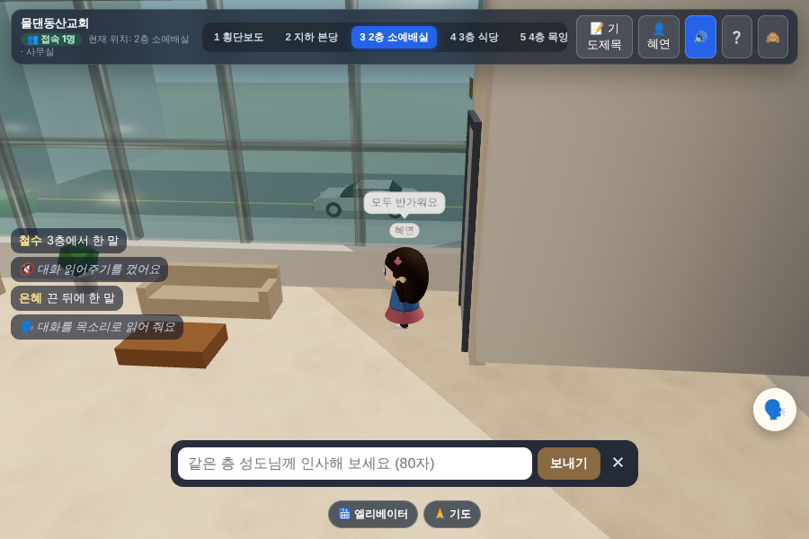

## "소리가 안 나" → 이유를 화면에 알려 주기 (`tools/walk-check/ttsfail.cjs`)
- 카카오톡·밴드·네이버 같은 앱 안 브라우저(특히 안드로이드)는 음성 기능(speechSynthesis)이 아예 없음 → 🗣️ 단추를 숨기지 않고 🔇로 보여 주고, 대화를 치거나 단추를 누르면 "앱 안에서 열면 목소리가 안 나와요" 안내 + **브라우저로 열기** 단추.
  - 카카오톡: `kakaotalk://web/openExternal?url=…` (기본 브라우저로 열기), 그 밖의 안드로이드 앱: 크롬 intent 주소, 아이폰 다른 앱: "⋯ 메뉴에서 Safari로 열기" 안내.
- 음성 기능은 있는데 4초 안에 말이 시작되지 않으면 "무음(진동) 모드를 풀고 소리를 키워 주세요" 안내. 소리 오류(not-allowed 등)도 안내. 같은 안내는 한 번만, 45초 동안 보여 줌.
- 크롬에서 말 줄이 막히는 문제 대비: 첫 누름 때 줄을 비우고 빈 말로 음성을 깨움, 20초 넘게 안 끝난 말은 정리, 말하는 동안 말 객체를 잡아 둠.
- 결과: 카카오톡(안드로이드) 흉내 → 🔇 단추·안내·브라우저로 열기 단추 ✅, 말이 시작되지 않음 → 무음 모드 안내 ✅, 정상 읽어주기(tts.cjs) 그대로 ✅, 페이지 오류 없음.

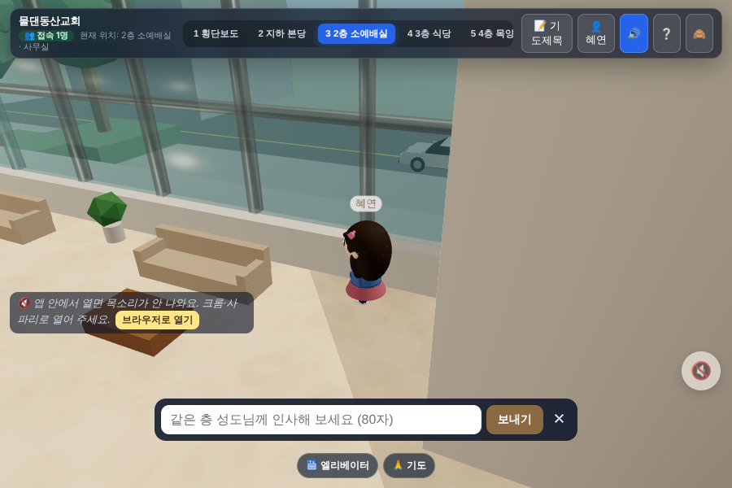

## 카카오톡에서 열면 자동으로 바깥 브라우저로 넘기기
- 사용자 확인: 카카오톡 안에서 열면 목소리가 안 나오고, 바깥 브라우저로 열면 됨 → 카카오톡(UA에 `KAKAOTALK`)으로 들어오면 `<head>`에서 바로 `kakaotalk://web/openExternal?url=…`로 기본 브라우저(크롬·사파리)를 엶. 한 번만 시도(`sessionStorage.mdc_out_tried`).
- 넘기기에 실패하면 그 화면의 나머지 불러오기가 끊기는 것을 시험에서 발견(크롬은 알 수 없는 주소로 이동을 시작하면 남은 스크립트를 멈춤) → 본 화면 코드(`window.__mdcMain`)가 안 돌았는데 불러오기가 끝났으면 한 번 다시 불러옴(이때는 넘기지 않음). 다시 불러온 화면은 정상 동작 + "앱 안에서는 목소리가 안 나와요" 안내와 **브라우저로 열기** 단추.
- 결과: 넘기기 시도 → 실패 → 다시 불러옴 → 화면 정상·안내·단추 1개 ✅, 다시 불러와도 또 넘기지 않음 ✅, 카카오톡이 아닌 브라우저는 넘기지 않음 ✅, 정상 읽어주기 그대로 ✅, 페이지 오류 없음.
- 실제 카카오톡 앱에서 넘어가는 모습은 이 컴퓨터에서 볼 수 없음 → 사이트에 올린 뒤 휴대폰으로 확인 필요.

## 아동부실 · 2층 강대상 · 3층 주방 (`tools/walk-check/rooms1107.cjs`)
사용자 요청(휴대폰 사진 2장): ① 4층 아동부실 풍선이 너무 높음, 의자는 모두 없애고 양쪽 벽에 장난감장·낮은 책장(크지 않게) ② 2층 소예배실 강대상이 높음(캐릭터에 맞게) ③ 3층 주방 퀄리티가 별로 — 냄비·프라이팬·가스레인지 등 자세히.
(아동부실 화면 그림을 "첨부 이미지로" 바꾸는 것은 그림이 오지 않아 사용자에게 다시 요청)

- **아동부실**: 어린이 의자 24개 치움. 양쪽 벽에 낮은 그림책장(높이 0.44m, 책 두 칸 + 위에 세운 그림책)과 장난감장(높이 0.4m, 2단 칸마다 파스텔 바구니, 위에 쌓은 블록·공·곰 인형·장난감 자동차)을 서쪽 3개·동쪽 3개. 화장실 문(z -14.4~-13.6)은 비움. 예전 큰 책장(동쪽)도 치움. 작은 조각은 재질별로 합쳐 한 덩어리, 걷기 막힘은 보이지 않는 상자가 맡음.
- **풍선**: 높이 1.5m → 0.95m(아래 끝 0.8m), 자리를 강단 위 양쪽 끝으로 옮겨 찬양 화면을 가리지 않음.
- **2층 강대상**: 몸통 0.5m → 0.3m (윗면이 바닥에서 0.64m → 0.44m, 강단 위로 0.34m = 캐릭터 가슴 높이).
- **3층 주방**: 가운데 조리대를 스테인리스로(폭 1.6 → 1.2m, 문짝·손잡이), 북쪽에 6구 가스레인지(버너 고리·삼발이·파란 불꽃·불 조절 손잡이) 위에 들통(국물·국자)·빨간 법랑 냄비(유리 뚜껑)·프라이팬(계란 프라이)·웍(볶음 채소, 나무 손잡이)·주전자, 위에 후드(거름망·불빛)와 천장까지 덕트. 남쪽 손질 자리에 도마·칼·당근·대파·양배추·토마토·감자·양파·스테인리스 볼·접시·간장/식용유/고춧가루/소금·조리도구 꽂이.
  서쪽 벽에 개수대 줄: 두 칸 싱크·거위목 수전·식기 건조대(접시·그릇)·칼꽂이·업소용 가스 밥솥·대야·고추장/간장 통·전자레인지, 흰 타일 벽, 벽 선반(접시·그릇·양념병), 조리도구 걸이(국자·뒤집개·거품기·집게·주걱). 북동쪽에 업소용 4도어 냉장고, 동쪽 벽 철제 선반(쌀 포대·냄비·식용유 통·상자·쟁반).
- 주방 안 길: 문 앞 → 개수대 앞 / 냉장고 앞 / 선반 앞 / 조리대 남쪽 모두 길 있음 ✅. 아동부실 문 앞 → 네 책장 앞 모두 바로 감 ✅. 페이지 오류 없음.
- 실수 기록: 타일 벽 줄에서 `//` 설명 뒤에 같은 줄로 코드를 붙여 타일이 안 보였음 → 설명을 줄 끝으로 옮겨 고침(예전과 같은 실수, 새 코드 전체를 다시 훑어 같은 문제 없음 확인).

| | 전 | 후 |
|---|---|---|
| 아동부실 | 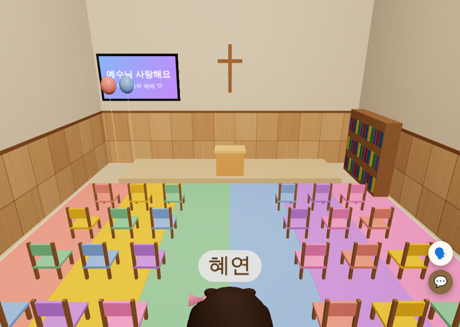 | 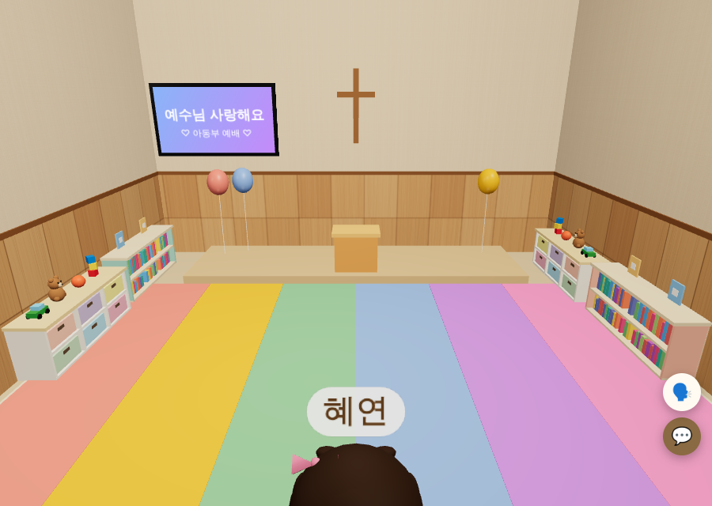 |
| 2층 강대상 | 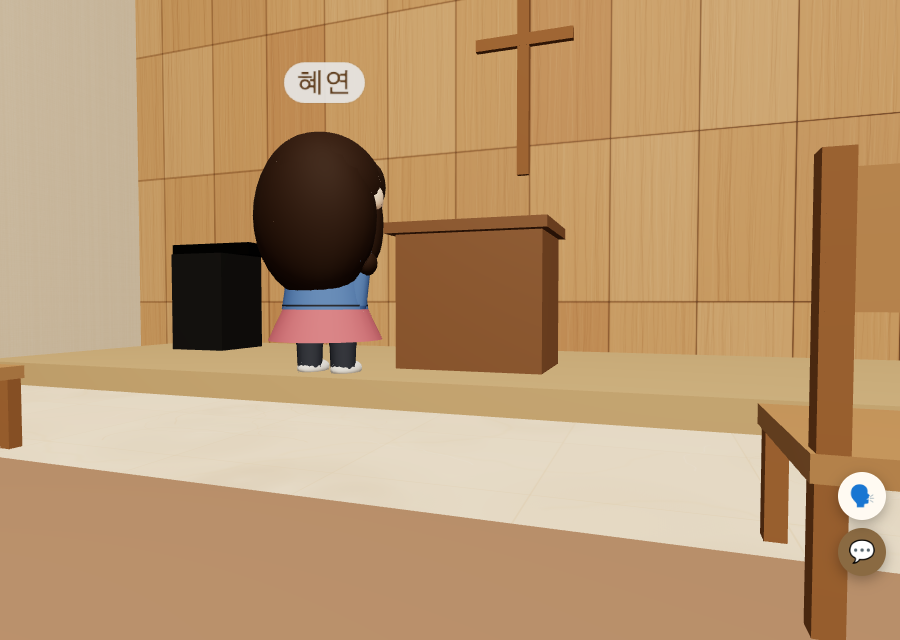 | 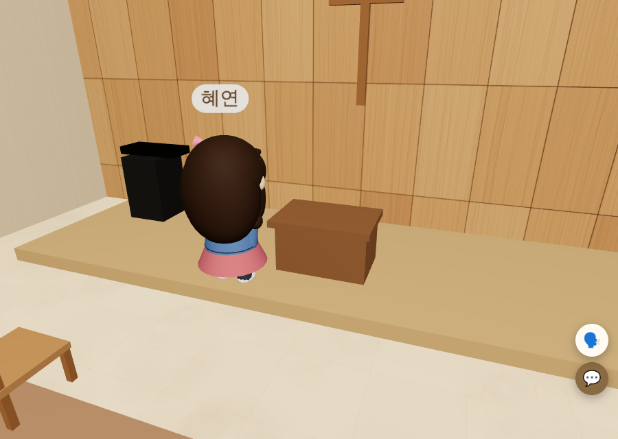 |
| 주방 가스레인지 | 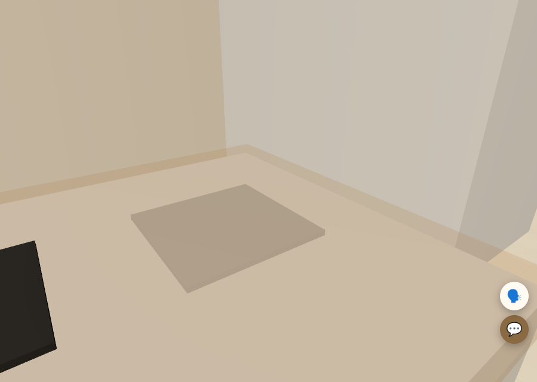 | 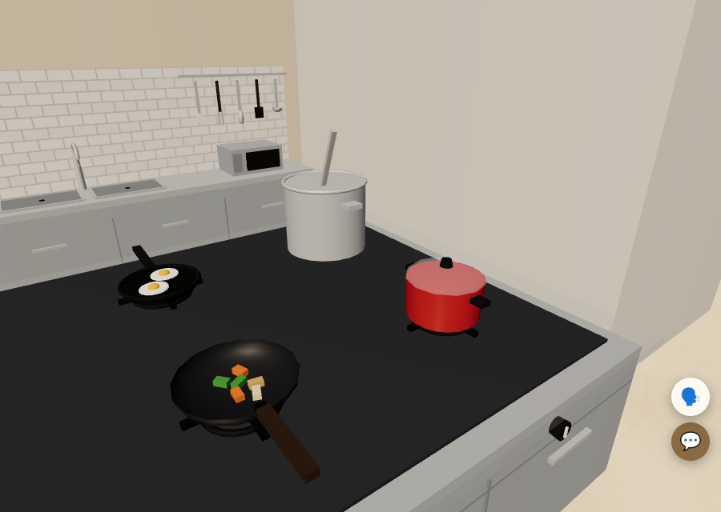 |

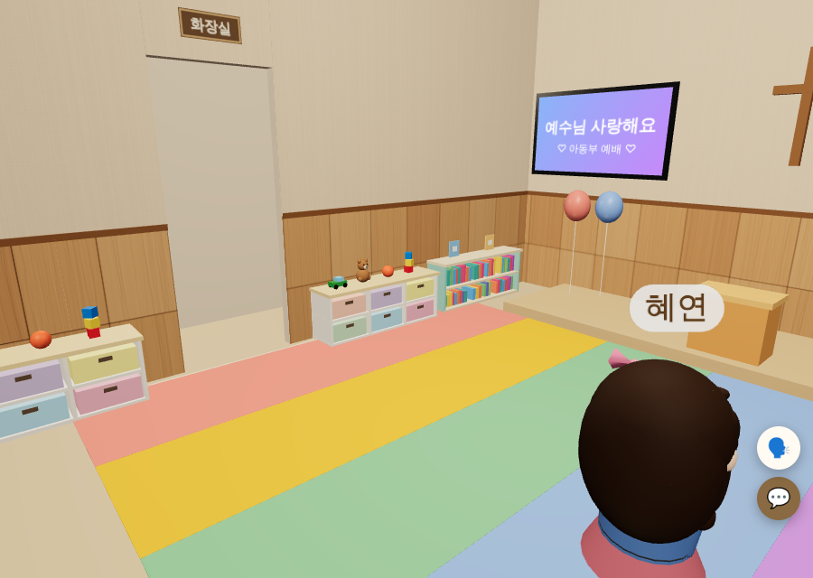 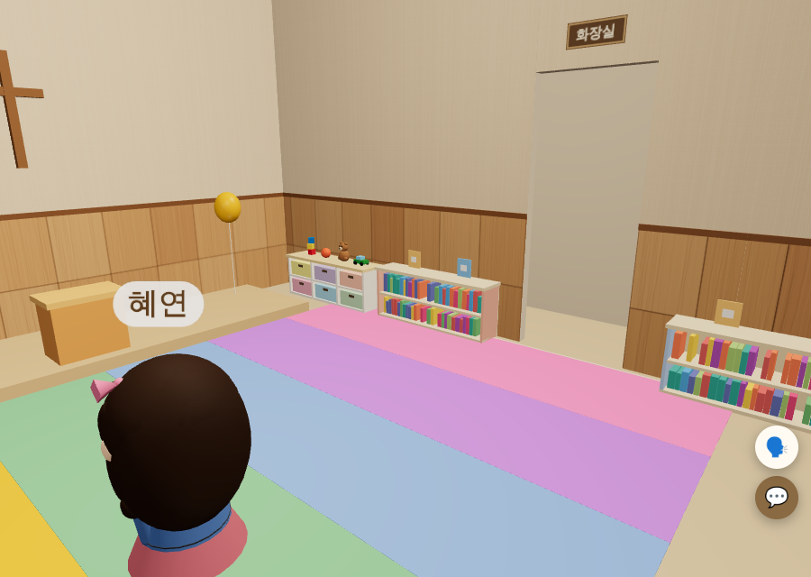 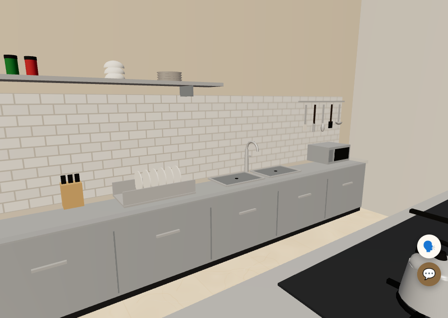 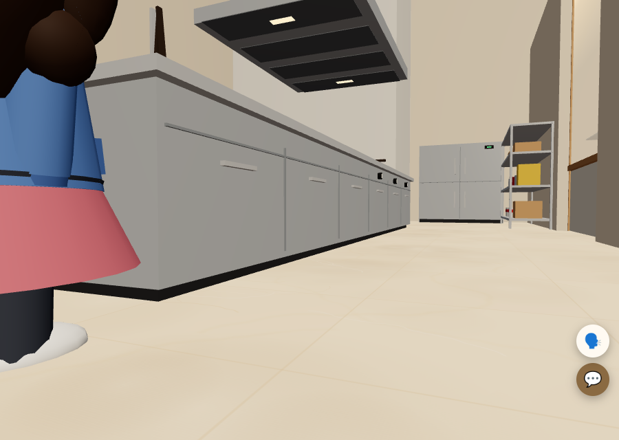

## 아동부실 찬양 화면 그림 바꿈
- 사용자가 보낸 그림(예수님과 어린 양들 · "예수님 사랑해요", 1672×941)을 1280×720 JPEG로 줄여 `assets/screen/kids-jesus-love.jpg`(97KB)로 넣음. 화면 판을 16:9(1.32×0.743m)로 맞추고 검은 테두리도 살짝 키움. 그림을 못 불러오면 예전 글씨 그림이 그대로 보임.
- 결과: 화면에 그림이 또렷이 보임 ✅, 페이지 오류 없음.

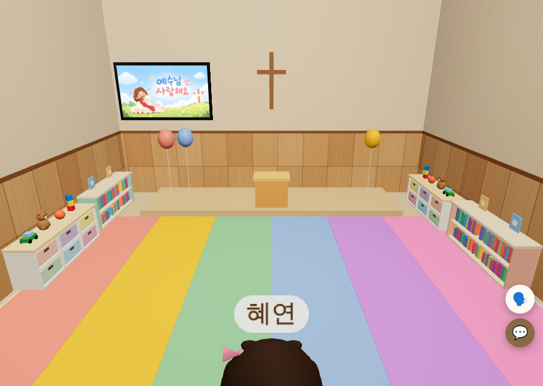 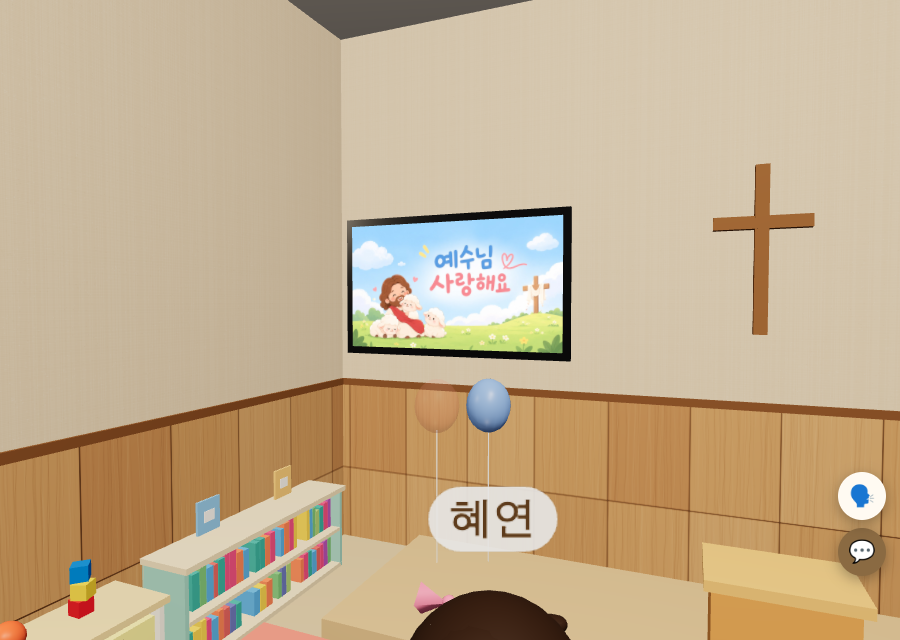
- 사용자 "벽 끝에 너무 붙음" → 화면 가운데를 x -7.3에서 -6.985로(서쪽 벽 x -8.06과 십자가 왼팔 끝 x -5.91의 한가운데, 양쪽 빈틈 0.375m씩).

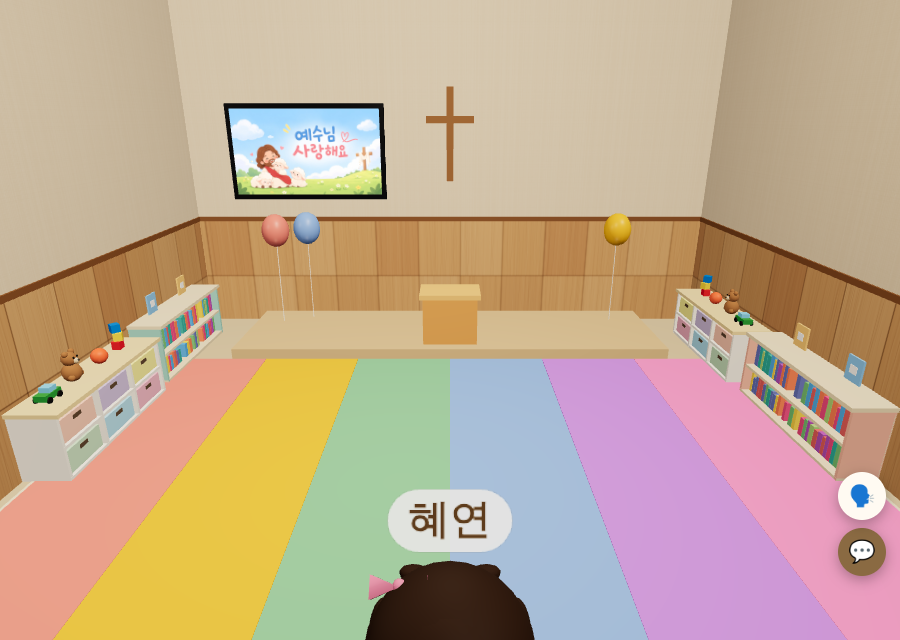

## 기도제목 함께 보기 · 자모실 · 3층 배식대 (`tools/walk-check/prayshare.cjs`, `tools/walk-check/jamo.cjs`)
사용자 요청: 서버 나누기는 나중에, 먼저 ① 기도제목을 누구나 볼 수 있게 ② 자모실 앞 상자 같은 것이 가려 보임 → 아기 장난감장 작게 ③ 자모실 창이 캐릭터보다 높음 → 낮게 ④ 3층 배식대도 주방처럼 자세히.

### ① 기도제목 함께 보기
- Supabase 표 `prayers` + 함수 `add_prayer` · `delete_prayer` · `pray_prayer` (글: `docs/supabase/prayers.sql`, 사용자가 대시보드 SQL Editor에서 한 번 실행해야 켜짐).
  읽기는 누구나(글·분류·이름·함께 기도 수·시각만), 쓰기·지우기·함께 기도는 함수로만, 지우기는 글 쓴 휴대폰의 비밀 열쇠(`mdc_owner_key`, 기기 번호와 따로, 남에게 보내지 않음, 서버엔 md5만)로 확인, 한 휴대폰 10분에 5개까지.
- 화면은 `fetch`로 `apikey` 헤더만 보냄(Authorization 헤더 없음 — 새 Publishable 키 방식에 맞춤). 표가 없거나 인터넷이 안 되면 예전처럼 이 휴대폰에만 저장하고 안내.
- 예전에 휴대폰에만 적은 기도제목은 그 사람에게만 "📱 나만 보임"으로 보이고 "모두와 나누기"로 올릴 수 있음.
- 누가 올리기·지우기·함께 기도를 하면 같은 방 사람들에게 신호('prayer')를 보내 다시 불러옴 + 1분 반마다 확인.
- 이 컨테이너에서는 supabase.co에 접속이 막혀 있어(프록시 403), 같은 규칙의 가짜 서버를 끼워 시험:
  처음 목록(다른 사람 글 + 나만 보임 글) ✅, 함께 기도 +1/취소 -1 ✅, 올리기 ✅, 다른 기기 B에 새 글 보임 ✅, 나누기 뒤 B에 신호로 반영 ✅, 지우기(서버·B 모두) ✅, 3D 게시판 반영 ✅, Authorization 헤더 0건 ✅, 표 없을 때(404) 안내 + 이 휴대폰 저장 ✅, 페이지 오류 없음.
  (시험의 A·B는 같은 브라우저라 저장소를 같이 써서 B에도 A 글 지우기 단추가 보였음 — 실제 휴대폰끼리는 열쇠가 달라 안 보임)
- **실제 Supabase에서 확인하는 일은 사용자가 SQL을 실행한 뒤 휴대폰 두 대로 해야 함.**

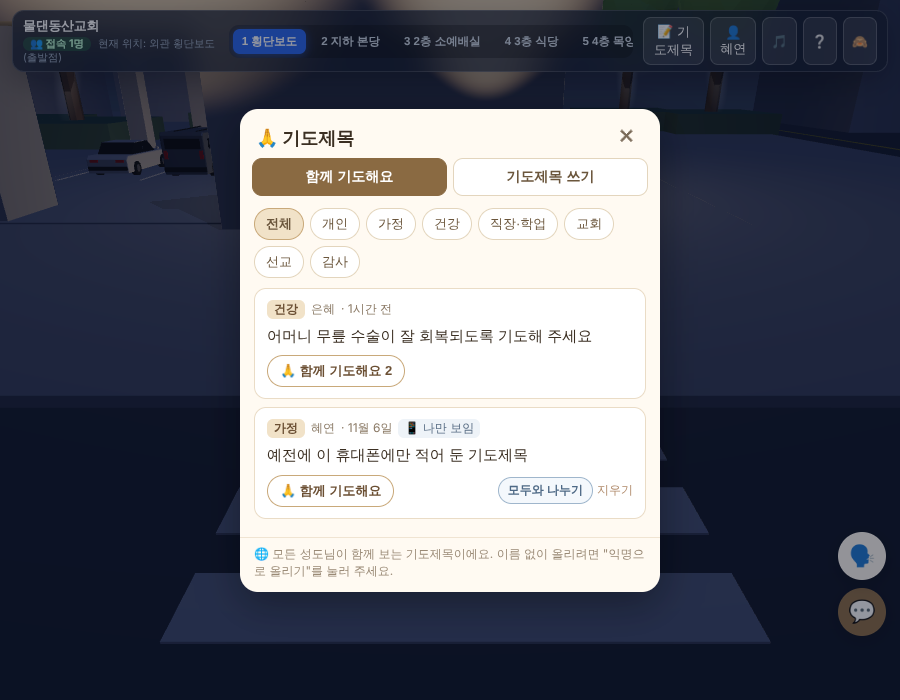

### ② ③ 자모실
- 상자처럼 보이던 아기 침대 3개와 작은 의자(상자)를 치움. 북쪽 끝 벽에 작은 아기 장난감장(폭 0.8 · 높이 0.28m, 파스텔 바구니 6칸, 위에 링 쌓기·고무 오리·딸랑이), 매트 위에 아기 놀이 아치(모빌), 작은 말랑 블록·공. 모두 0.3m 아래라 창 너머를 가리지 않음.
- 홀 쪽 창 아래 벽 0.9m → 0.3m (유리는 0.3~2.2m).

| 전 | 후 |
|---|---|
| 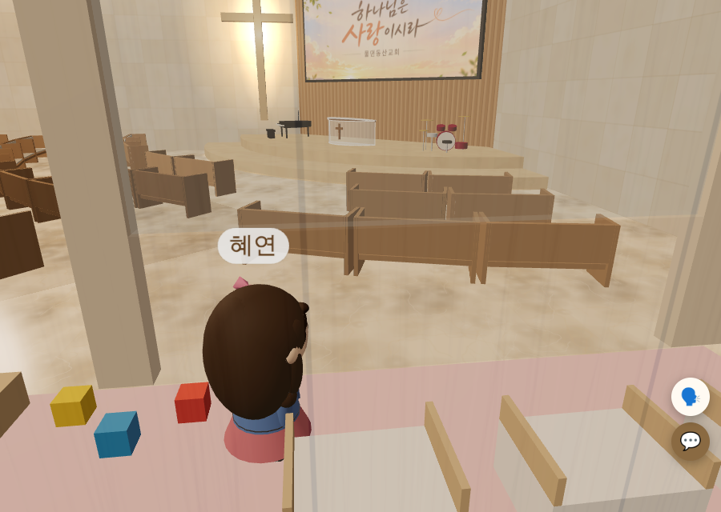 | 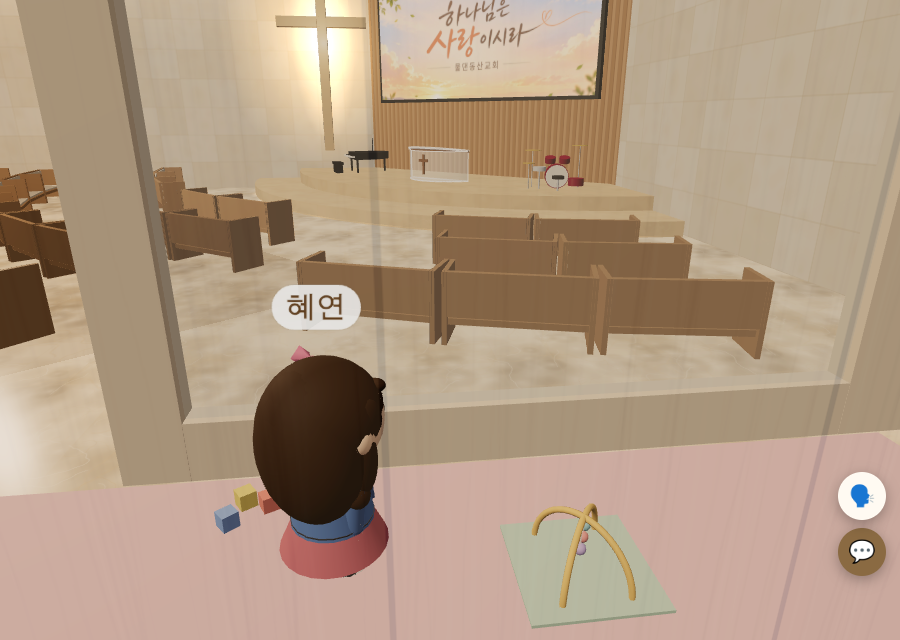 |

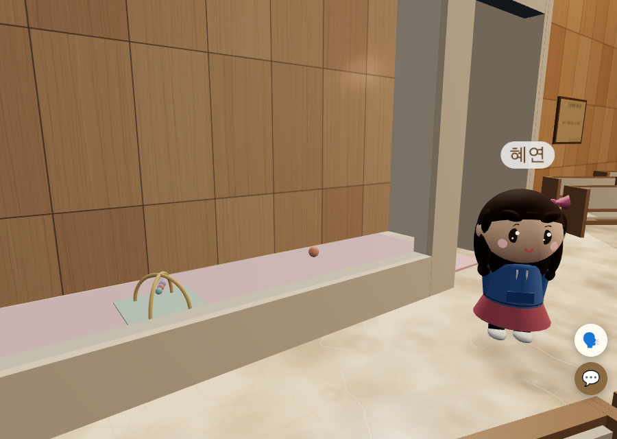 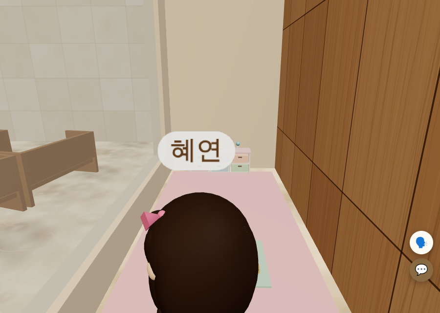

### ④ 3층 배식대
- 몸통 스테인리스 + 먹는 쪽 원목 앞판(줄눈) + 식판 미는 레일(받침 3개, 걸음도 막음).
- 위: 식판 더미(꽂이)·숟가락통·젓가락통 → 쌀밥(소복한 밥·주걱) → 미역국(둥근 국통·미역·국자) → 제육볶음(집게) → 배추김치(집게) → 계란말이·시금치나물(반 칸씩). 칸마다 메뉴 이름표.
- 2단 유리 가림막(스테인리스 기둥 3개, 앞 유리, 위 유리 선반에 밥공기·국그릇 더미, 아래 보온등), 벽에 '오늘의 메뉴' 칠판.
- 처음엔 반찬통 음식 바닥 판이 통 윗면 아래에 묻혀 안 보였음 → 통 위로 올려 고침.

| 전 | 후 |
|---|---|
| 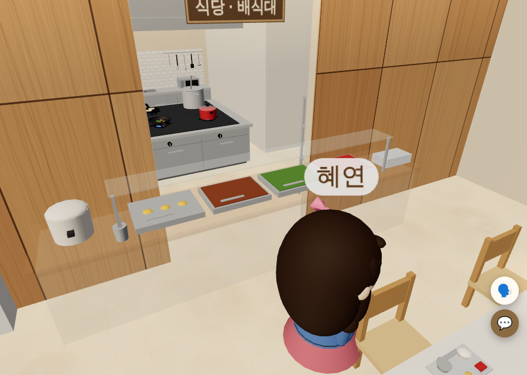 | 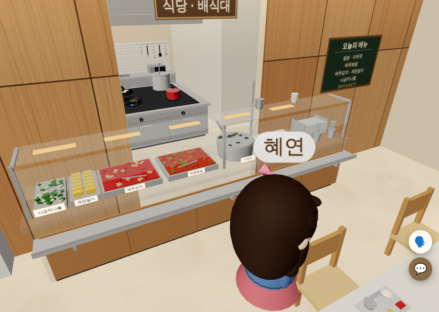 |

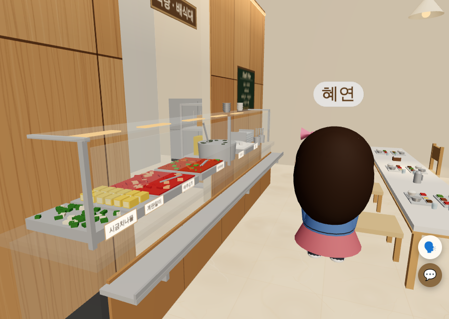
